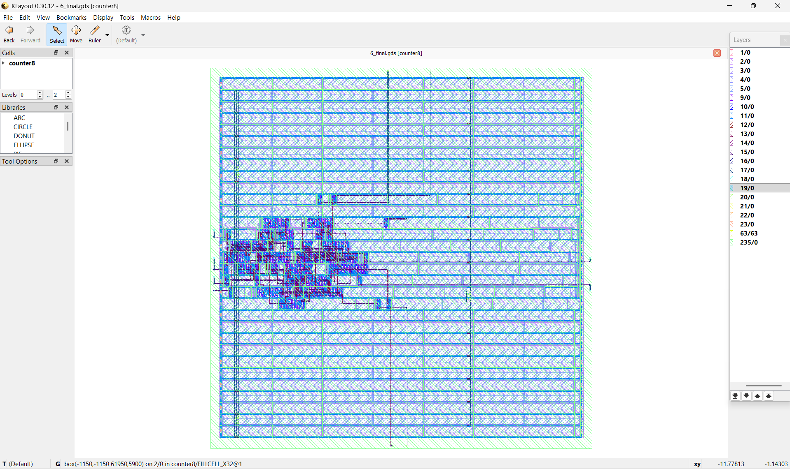
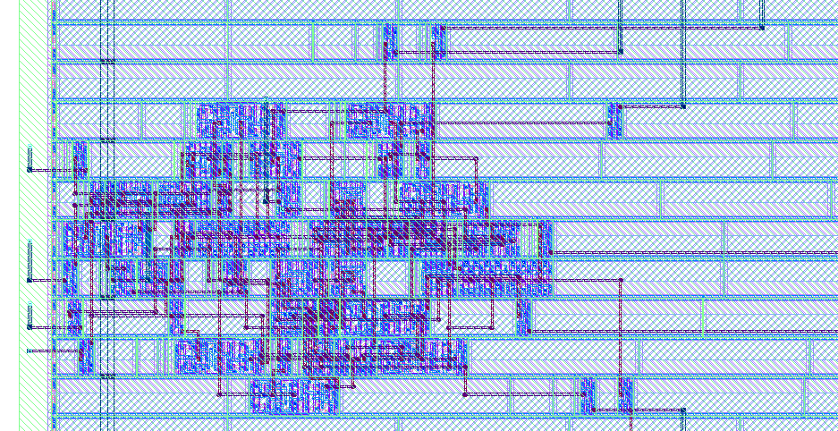

# RTL-to-GDSII Physical Design of an 8-bit Configurable Counter

A self-directed, hands-on exploration of digital design, RTL verification, physical implementation, and timing analysis using open-source EDA tools.

## Project Overview

This project implements a parameterized synchronous counter with enable, synchronous reset, and terminal-count detection.

The objective was to independently learn and validate the RTL-to-GDSII workflow, troubleshoot a physical design constraint, and analyse results using actual EDA reports.

**Tools:** Icarus Verilog 12.0, Yosys, OpenROAD Flow Scripts, Nangate45, KLayout 0.30.12.

## Physical Layout



*Figure 1. Final GDSII layout of the 8-bit counter, viewed in KLayout.*



*Figure 2. Zoomed-in view showing placed standard cells and routed interconnect.*

## Implementation Flow

RTL Design → Functional Simulation → Synthesis → Floorplanning → Placement → Clock Tree Synthesis → Routing → GDSII

## Verified Results

| Metric | Result |
|---|---:|
| Functional verification | 266/266 checks passed |
| Synthesized standard cells | 46 |
| Synthesis cell area | 96.824 µm² |
| Core area | 1,896.580 µm² |
| Effective core utilization | 5.1% |
| Reported critical path slack | +7.7262 |
| Setup violations | 0 |
| Hold violations | 0 |
| Final detailed-routing violations | 0 |
| Final GDSII | Generated (151 KB) |

**Timing constraints:** 10 ns clock period with illustrative 2 ns input/output delays. The reported timing values are specific to this design, platform, and constraint setup.

## Engineering Challenge: PDN-0185

The initial implementation at 30% target core utilization failed during power distribution network (PDN) generation.

OpenROAD reported insufficient width for power straps: 17.67 µm available versus 28.5 µm required.

I inspected the floorplanning logs, identified the small core dimensions as the likely cause, and tested a controlled reduction in target utilization from 30% to 5%.

The resulting core area increased from 296.856 µm² to 1,896.580 µm², allowing the flow to generate the final GDSII.

The 5% setting was chosen as a conservative feasibility experiment, not an area-optimized production target.

## Repository Contents

- `rtl/` — Counter RTL
- `testbench/` — Self-checking functional testbench
- `constraints/` — Timing constraints (SDC)
- `flow/` — OpenROAD design configuration
- `results/` — Simulation, synthesis, timing, routing, floorplanning and GDS evidence
- `images/` — Actual KLayout screenshots
- `docs/` — Validation log and technical summary

## Reproduction

This design was developed using OpenROAD Flow Scripts (ORFS) with the Nangate45 platform.

Reference ORFS commit: `64939f3`.

The repository contains the custom design files rather than a full copy of ORFS. To reproduce the flow:

1. Obtain the reference version of ORFS and its required Docker environment.
2. Copy `rtl/counter8.v` to `flow/designs/src/counter8/counter8.v` in ORFS.
3. Copy `flow/config.mk` from this repository to `flow/designs/nangate45/counter8/config.mk` in ORFS.
4. Copy `constraints/constraint.sdc` to `flow/designs/nangate45/counter8/constraint.sdc` in ORFS.
5. From the ORFS `flow` working directory, run:

```bash
make DESIGN_CONFIG=./designs/nangate45/counter8/config.mk FLOW_VARIANT=pdnfix
```

To reproduce the functional simulation with Icarus Verilog:

```bash
iverilog -g2012 -s counter8_tb -o counter8_sim rtl/counter8.v testbench/counter8_tb.v
vvp counter8_sim
```

The included configuration uses the 5% utilization setting. Reproduction depends on compatible tool and platform versions.

## Limitations

- Nangate45 is an educational open platform, not a commercial MediaTek process.
- Positive timing slack and zero reported routing violations do not constitute complete industrial signoff.
- Power, process variation and comprehensive signoff checks were outside this project's scope.
- Core utilization was adjusted for feasibility; no area optimization claim is made.

## Key Learning

This project reinforced the importance of establishing a working baseline, validating RTL behaviour, investigating actual tool logs, testing controlled changes, and separating measured results from assumptions.
